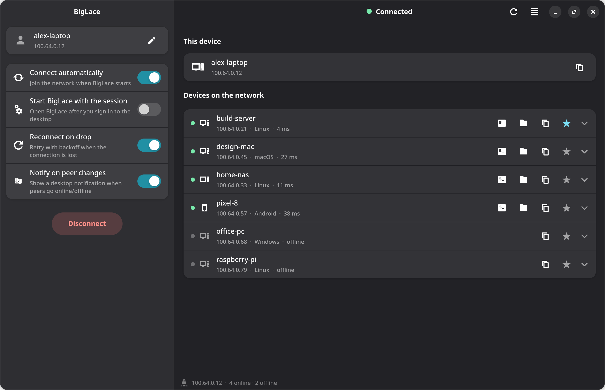
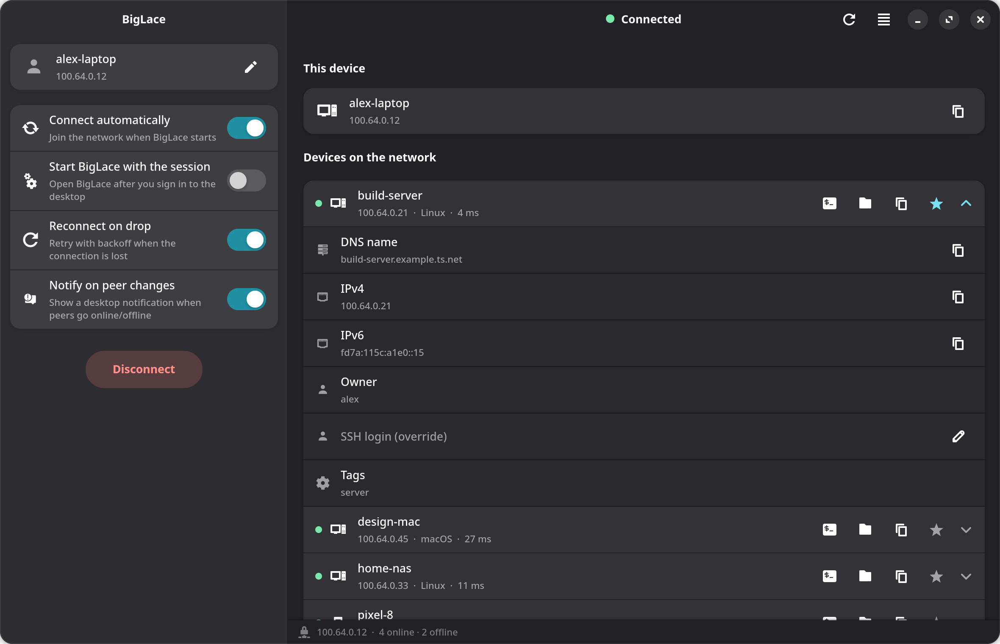

<div align="center">


# BigLace

**A native mesh VPN client for BigScale and Headscale — on Linux, Windows and Android.**

[](https://github.com/big-comm/biglace/releases)
[](LICENSE)
[](#download)
[](https://gtk.org)
[](mobile/android)

[Download](#download) ·
[Features](#features) ·
[Getting started](#getting-started) ·
[Build from source](#build-from-source) ·
[Contributing](#development)

<br>

<picture>
  <source media="(prefers-color-scheme: dark)" srcset="docs/screenshots/overview-dark.png">
  <source media="(prefers-color-scheme: light)" srcset="docs/screenshots/overview-light.png">
  
</picture>

<sub>Screenshots use a fictitious network.</sub>

</div>

---

BigLace puts your private mesh network one click away. Join a BigScale or
Headscale tailnet, see every device you own at a glance, and open an SSH
terminal or browse files on any of them without remembering a single IP
address.

- **Desktop (Linux and Windows)** — a GTK4 / libadwaita app that drives the
  system `tailscale` client and lives in the tray.
- **Android** — a standalone app that joins the network in-process (embedded
  `tsnet`, no separate VPN app) and ships its own SSH terminal and SFTP file
  manager.

## Features

<table>
<tr>
<td width="50%" valign="top">

### Desktop

- **One-click connect** — reconnects without a key once the device is enrolled.
- **Live device list** with online state, OS, latency and owner; pinned
  devices stay on top.
- **SSH and SFTP in one click** — opens the terminal and file manager you
  actually use (Ashyterm, Konsole, GNOME Console, Dolphin, Nautilus, …;
  WinSCP on Windows).
- **Sign in with a panel account** — BigLace requests a fresh pre-auth key
  for you; no copy-pasting.
- **Tray icon** with quick connect / disconnect; optional start with the
  session, hidden in the tray.
- **Auto-reconnect** with exponential backoff and **peer notifications**
  with flap protection.
- **Rename the device**, set a per-device SSH login, and route traffic
  through any peer that offers itself as an **exit node**.
- **Update notice** when a newer release is published.
- **29 languages**, credentials in the OS keyring.

</td>
<td width="50%" valign="top">

### Android

- **Joins the tailnet inside the app** (`tsnet`) — no Tailscale app, no
  device-wide VPN, keeps running as a foreground service.
- **SSH terminal** with a real VT emulator: colours, full-screen TUIs
  (vim, htop, Claude Code), extra keys, PgUp/PgDn, copy / paste, hardware
  keyboards, pinch to zoom.
- **SFTP file manager** — browse, search, sort, upload, open, share, rename,
  move and delete, with progress and cancellable transfers.
- **Multiple sessions** in tabs, one per device.
- **Key or password authentication**, generated SSH keys, trust-on-first-use
  host keys with a clear warning when a key changes.
- **In-app updates** from GitHub Releases, verified before installing.
- Secrets encrypted with the Android Keystore.

</td>
</tr>
</table>

<div align="center">
<picture>
  <source media="(prefers-color-scheme: dark)" srcset="docs/screenshots/details-dark.png">
  <source media="(prefers-color-scheme: light)" srcset="docs/screenshots/details-light.png">
  
</picture>

<sub>Expand any device for its DNS name, addresses, owner, tags and a per-device SSH login.</sub>
</div>

## Download

Every release is published on the
[**Releases page**](https://github.com/big-comm/biglace/releases) with
packages for all platforms.

| Platform | Package | Notes |
|---|---|---|
| **Arch Linux, BigLinux, Manjaro** | `biglace-<version>-x86_64.pkg.tar.zst` | `sudo pacman -U biglace-*.pkg.tar.zst` — requires `tailscale`. |
| **Windows 10 / 11 (x64)** | `biglace-<version>-x86_64.msi` | Requires the official [Tailscale for Windows](https://tailscale.com/download/windows) service. |
| **Android 8+** | `biglace-mobile-<version>-vc<code>-<abi>.apk` | Most phones need `arm64-v8a`. Later updates install from inside the app. |
| **Other Linux distributions, macOS** | — | [Build from source](#build-from-source). The code builds on macOS, but no installer ships yet. |

On Linux, the `tailscaled` service must be installed and running. BigLace
offers to start it if it is stopped.

## Getting started

BigScale and Headscale involve three different things that are easy to mix up:

| Term | What it is | Where it goes in BigLace |
|---|---|---|
| **Server** | The coordination server (BigScale / Headscale), e.g. `https://vpn.example.com`. | **Server URL** |
| **Panel** | The BigScale web interface where an administrator manages users and keys. | Only in **Sign in with panel account** |
| **Pre-auth key** | A personal key an administrator creates for you in the panel. | **Pre-auth key** |

> [!IMPORTANT]
> The server's administrative API key (`hskey-api-…`) never goes into BigLace.
> It exists only so the panel can talk to the server.

### Option A — sign in with a panel account

Open the menu (☰) → **Sign in with panel account** and enter the panel
address, your panel username and password, and a name for this device.
BigLace asks the panel for a fresh pre-auth key and fills everything in.
Press **Connect**.

### Option B — use a pre-auth key

If an administrator sent you a key, expand **Advanced: use a pre-auth key** in
the sidebar and fill in:

- **Server URL** — e.g. `https://vpn.example.com` (`https://` is added if you
  leave it out);
- **Pre-auth key** — the key you received;
- **Device name** — how this device appears to others, e.g. `alex-laptop`.
  Spaces and accents are converted for you.

Press **Save**, then **Connect**. The key is only needed the first time: once
the device is registered, it reconnects without it.

### No more password prompts (Linux)

`tailscale up` and `tailscale down` need root or the configured *tailscale
operator*. Until then, BigLace asks for your password through polkit. To stop
the prompts, choose **Make this user the tailscale operator** in the menu once
— it runs `tailscale set --operator=$USER` with your permission.

On Windows the Tailscale service already accepts commands from local users.

## Privacy and security

- **Keys stay out of plain text.** Pre-auth keys and panel passwords live in
  the OS keyring (Secret Service, Windows Credential Manager, macOS Keychain);
  on Android they are encrypted with an Android Keystore key. Settings are
  still saved when no keyring is available.
- **Keys stay out of process lists and logs.** `tailscale up` reads the key
  from a private temporary file, never from the command line, and logs mask
  it.
- **HTTPS only** for the panel, with redirects disabled for credentialed
  requests and response sizes capped. Plain HTTP is accepted only for
  `localhost` during development.
- **No guessing on SSH.** Launchers validate host names and logins, and pick
  the tailnet address when MagicDNS answers with something else. Android pins
  SSH host keys on first use (SHA-256) and warns before accepting a changed
  one.
- **Verified updates.** The Android app installs only APKs downloaded from this
  repository's releases, checks their SHA-256 first, and Android itself
  requires the same signing key as the installed app.
- **Crash-safe settings.** Configuration is written atomically; a file that
  can't be read is backed up instead of overwritten.

## Configuration

Settings are stored per user:

| Platform | Location |
|---|---|
| Linux | `~/.config/biglace/config.toml` |
| Windows | `%APPDATA%\biglace\config.toml` |
| macOS | `~/Library/Application Support/biglace/config.toml` |

```toml
server_url          = "https://vpn.example.com"
hostname            = "alex-laptop"
enrolled            = true          # this device is registered and can reconnect without a key
auto_connect        = true
auto_reconnect      = true
notify_peer_changes = true
favorites           = ["build-server"]

[peer_overrides]                    # per-device SSH login
build-server = "deploy"
```

Everything can be changed from the app; secrets are never written to this
file.

## Build from source

### Linux

Runtime: `gtk4` (≥ 4.12), `libadwaita` (≥ 1.4), `tailscale`, `openssl`.
Build: `rust`, `cargo`, `pkgconf`.

```bash
cargo build --release --locked
./target/release/biglace
```

Arch / BigLinux package:

```bash
cd pkgbuild && makepkg -si
```

The `usr/` directory mirrors the installed layout (desktop entry, icons and
compiled translations), and the PKGBUILD copies it as-is.

> [!NOTE]
> Distribution packages are built with `--no-default-features`, which leaves
> out the bundled jemalloc allocator; some hardened linker setups can't link
> it.

### Windows

The MSI is built by [`.github/workflows/windows.yml`](.github/workflows/windows.yml)
with a pinned [gvsbuild](https://github.com/wingtk/gvsbuild) GTK4 runtime and
WiX 3. To build manually on Windows with Rust (MSVC), WiX 3 and gvsbuild:

```powershell
cargo build --release --no-default-features --target x86_64-pc-windows-msvc
cargo install cargo-wix --locked --version 0.3.9
heat.exe dir target\wix-stage -cg RuntimeFiles -dr APPLICATIONFOLDER -ag -srd -sfrag -var var.StageDir -out wix\runtime.wxs
cargo wix --no-build --nocapture --target x86_64-pc-windows-msvc -C "-dStageDir=target\wix-stage"
```

### Android

Requires JDK 17 and the Android SDK (platform 36). The embedded network engine
(`mobile/android/app/libs/tsbridge.aar`) is committed, so Go and the NDK are
only needed to rebuild it.

```bash
cd mobile/android
./gradlew testDebugUnitTest lintDebug assembleDebug   # debug APKs, one per ABI
../dist/build-apk.sh                                  # signed release APKs in mobile/dist/
```

Rebuild the engine after changing [`mobile/tsbridge`](mobile/tsbridge):

```bash
cd mobile/tsbridge && ./build-aar.sh
```

More detail in [`mobile/dist/README.md`](mobile/dist/README.md) (signing and
release APKs) and [`mobile/ARCHITECTURE.md`](mobile/ARCHITECTURE.md).

## Development

### Releases and versioning

Packages are produced with **gitrepo**, which publishes a GitHub release for
each build.

- **Version.** `APP_VERSION` in [`src/main.rs`](src/main.rs) is the app's
  semantic version. gitrepo bumps it on every commit it creates: `feat` →
  minor, `fix` / `perf` / `docs` / … → patch, breaking change → major. Keep it
  a plain `"MAJOR.MINOR.PATCH"` literal so gitrepo can find it.
- **Build stamp.** The PKGBUILD also embeds the build date (`YY.MM.DD-HHMM`,
  the release tag format), which the update notice compares with the latest
  release.
- **One release, every platform.** Publishing a release triggers the
  [Windows](.github/workflows/windows.yml) and
  [Android](.github/workflows/android.yml) workflows, which attach the MSI
  and the APKs to that same release. The Android job takes its version from
  the tag and signs with the key stored in the repository secrets
  (`ANDROID_KEYSTORE_BASE64`, `ANDROID_KEYSTORE_PASSWORD`, `ANDROID_KEY_ALIAS`,
  `ANDROID_KEY_PASSWORD`).

### Checks

```bash
# Desktop
cargo fmt --all -- --check
cargo test --all-targets --locked
cargo clippy --all-targets --locked -- -D warnings
cargo audit --deny warnings

# Android
cd mobile/android && ./gradlew testDebugUnitTest lintDebug assembleDebug

# Network engine
cd mobile/tsbridge && go test -race ./... && go mod verify
```

Packaging files can also be checked with `shellcheck`, `namcap`,
`desktop-file-validate` and `msgfmt -c`.

### Translations

Translations live in `locale/<lang>.po` (languages listed in
`locale/LINGUAS`). The template and the compiled catalogues under
`usr/share/locale/` are regenerated by the project's translation pipeline,
which extracts strings marked with `tr!` / `trf!`. To add a language, add its
code to `locale/LINGUAS` and translate a copy of `locale/biglace.pot`
(use `pt_BR`, not `pt-BR`).

To try local catalogues, point `BIGLACE_LOCALEDIR` at them.

### Project layout

```
biglace/
├── src/                     Desktop app (Rust, GTK4 + libadwaita)
│   ├── main.rs              entry point, APP_VERSION
│   ├── tailscale.rs         tailscale CLI, peer parsing, SSH / SFTP launchers
│   ├── panel.rs             BigScale panel client
│   ├── config.rs            settings file
│   ├── secrets.rs           OS keyring
│   ├── tray.rs, tray/       tray icon (Linux · Windows · stub)
│   └── window/              main window, sidebar, peer rows, dialogs
├── mobile/
│   ├── android/             Android app (Kotlin, Jetpack Compose)
│   ├── tsbridge/            Go bridge embedding tsnet, built as an AAR
│   └── dist/                release APK build script
├── usr/                     installed files: desktop entry, icons, translations
├── locale/                  translation sources
├── pkgbuild/                Arch / BigLinux package
├── wix/                     Windows installer
├── docs/screenshots/        images used in this README
└── .github/workflows/       Windows and Android release pipelines
```

## License

BigLace is released under the [MIT License](LICENSE).

<div align="center">
<sub>Made by the <a href="https://github.com/big-comm">BigCommunity</a>.</sub>
</div>
